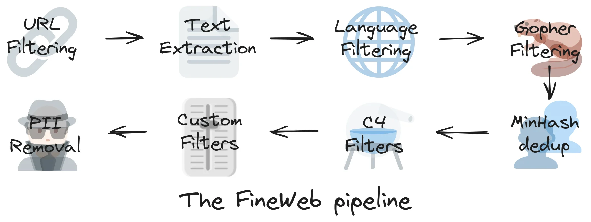
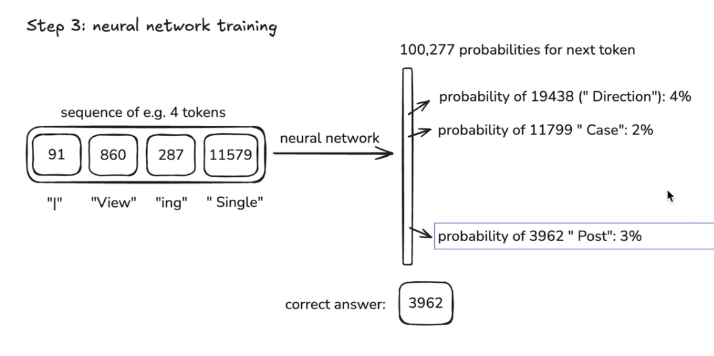
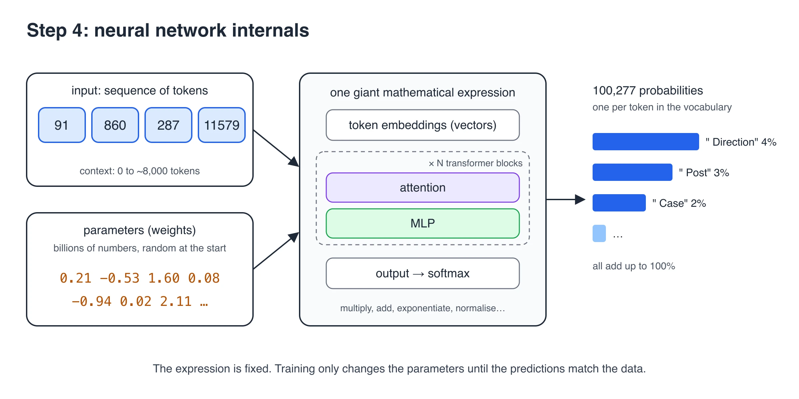
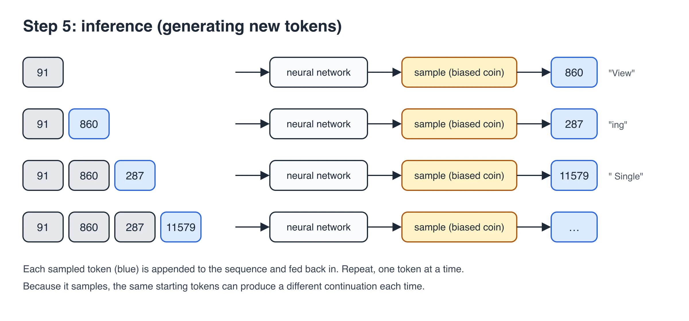

# Pre-Training & Tokens

The pre-training stage is the foundational and most resource-intensive phase of building a large language model (LLM), where a neural network learns general language patterns from massive amounts of unlabeled text.

## 1. Download and pre-process the internet



Note: You don't need to know each step in detail. Just know that crawlers like **Common Crawl** (an organisation that has been crawling the internet since 2007) collect the raw web pages, and **Hugging Face** has built [**FineWeb**](https://huggingface.co/datasets/HuggingFaceFW/fineweb), a public dataset for LLM pre-training.

FineWeb is produced by running that raw data through the deep filtering steps shown above: removing HTML tags, sidebars, navbars and other unimportant content, removing pages in other languages, and removing unwanted sites such as adult, scam and ad sites.

## 2. Tokenisation

Before we send these billions of texts to the neural network, we need to decide how to represent them.

A neural network expects a one-dimensional sequence of symbols drawn from a finite set of possible symbols.

To see each step, follow one small piece of text through the pipeline: [example text](/how-llms-work/pre-training-tokens/1-text.txt) (673 characters).

1. Text -> UTF-8 encoding -> binary bits

   Example: [bits file](/how-llms-work/pre-training-tokens/2-bits.txt) (5,384 bits).

   Bits give a very long sequence with only 2 symbols, and we want shorter sequences. LLMs prefer shorter sequences mainly to manage computational cost: attention compares every token with every other token, so the compute (FLOPs, floating-point operations) grows roughly with the square of the sequence length. Shorter sequences also let more text fit into the model's context window.

2. Take groups of 8 bits and convert each group to a byte, which gives 256 possible values (0 to 255).

   Binary bits -> bytes -> 8x shorter sequence with 256 symbols

   Example: [bytes file](/how-llms-work/pre-training-tokens/3-bytes.txt) (673 bytes).

3. Find the most common pairs of consecutive bytes (or symbols) and merge each pair into a new symbol. Repeat this many times. This algorithm is called **Byte Pair Encoding (BPE)**.

   Bytes -> BPE -> even shorter sequence with ~100,000 symbols (the vocabulary size varies between models like ChatGPT, Claude etc. GPT-4 uses 100,277). These symbols are called **Tokens**

   Example: [tokens file](/how-llms-work/pre-training-tokens/4-tokens.txt) (140 tokens, using GPT-4's `cl100k_base` tokenizer). You can explore this yourself at [Tiktokenizer](https://tiktokenizer.vercel.app/).

## 3. Neural Network Training



We will take a batch of tokens from the dataset (window of tokens) and send it through NN, it predects the next token. Now, NN will have multiple options of next token with different probalities like (0.3, 0.2, 0.4).

As we know the answer (next token), we will run a mathamatical process to adjust the probability of these options so that we will get right answer next time.

This process happens paralelly in large batches and windows with entire data set, this is Neural Network Training. As we train more and more with the dataset, the probablity gets more consistant with the patterns these tokens follow in dataset.

## 4. Neural Network Internals



The neural network has two kinds of inputs:

1. **Tokens**: the sequence we want a prediction for. It can be anywhere from 0 tokens up to a maximum, the **context length or context window** (e.g. 8,000 tokens). Longer contexts are possible but cost more compute.
2. **Parameters (weights)**: billions of numbers. At the start they are set randomly, so the predictions are random too. Training is the process of finding a setting of these numbers that makes the predictions match the patterns in the dataset.

Think of the parameters as the knobs of a DJ set: by turning them, you get different predictions for each sequence of tokens.

The tokens and parameters are mixed together in **one giant mathematical expression** (lots of multiplications, additions, exponentials and normalisations) that produces the output probabilities. The modern design of this expression is called the **Transformer**:

You can explore a small Transformer (nano-GPT, ~85,000 parameters) step by step at [bbycroft.net/llm](https://bbycroft.net/llm).

Note: The intermediate values are often called "neurons", but they are far simpler than the neurons in your brain. The network has no memory: it is a fixed, stateless expression, so the same input and parameters always give the same output.

## 5. How Parameters Are Learned

During pre-training, parameters are not generated from scratch as the model reads. Instead, the total number of parameters is manually defined by engineers beforehand (the architecture setup), initialized with completely random numbers, and then systematically refined billions of times over.

The parameters transition from random noise to useful language knowledge through a continuous mathematical loop:

```text
[ 1. Initialization ]   ──> (Random numbers / "Blank slate")
          │
          ▼
[ 2. Forward Pass ]     ──> (Model guesses the next word)
          │
          ▼
[ 3. Loss Calculation ] ──> (Measures error against actual text)
          │
          ▼
[ 4. Backpropagation ]  ──> (Calculates how to adjust each dial)
          │
          ▼
[ 5. Optimization ]     ──> (Slightly updates weights & repeats)
```

### Step 1: Random Initialization

Before any text is read, developers establish the framework of the neural network (e.g., specifying a structure to hold exactly 8 billion parameters).

- Every single parameter (weight and bias) is assigned a tiny, random decimal number (e.g., 0.0034, -0.012).
- At this exact moment, the AI is completely blank. If you ask it to complete the sentence "The cat sat on the...", it might output "banana microwave window jump" because its internal connections have no logic.

### Step 2: The Forward Pass (Guessing)

The model is fed massive quantities of raw text data. It reads a sequence of tokens and attempts to predict the very next token.

- It passes the token numbers through its layers of random parameters using matrix multiplication.
- Because the parameters are random, its first millions of guesses will be entirely incorrect.

### Step 3: Loss Calculation (Measuring Mistakes)

The training system compares the model's prediction against the actual next word in the training text.

- A mathematical formula called a **loss function** calculates a single number (the "loss value") that represents exactly how far off the model's guess was. A high loss means a terrible guess; a low loss means a highly accurate guess.

### Step 4: Backpropagation (Calculating Adjustments)

Once the error is measured, the system passes this error signal backward through the layers of the network, a process known as **backpropagation**.

- Using calculus (specifically the chain rule), the system determines exactly how much responsibility each individual parameter had in causing that wrong guess.
- It generates a **gradient** for every parameter, which acts like a tiny arrow pointing in the direction the parameter needs to change to make a better guess next time.

### Step 5: Optimization (Turning the Dials)

An optimization algorithm (most commonly one called **Adam**) takes those gradients and slightly updates the parameter values.

- The parameters are adjusted by a microscopic fraction governed by a setting called the **learning rate**.
- If a parameter contributed to a good guess, it is reinforced; if it caused a bad guess, its value is shifted away.

### The Result

This whole cycle (Steps 2 through 5) is repeated across trillions of words of data for weeks or months at a time.

By repeating this billions of times, those initially random decimals slowly morph into highly structured numbers. These fine-tuned values implicitly map out how human concepts cluster together, how grammar operates, and how context shapes meaning, resulting in a fully functional **base model**.

## 6. Inference

Inference is generating new data from the model, i.e. seeing what patterns it has internalised in its parameters.



1. Start with some tokens as a prefix (e.g. token 91, "|").
2. Feed them into the network and get the probabilities for the next token.
3. **Sample** one token from those probabilities, like flipping a biased coin: tokens with higher probability are more likely to be picked, but not guaranteed.
4. Append the sampled token to the sequence and repeat from step 2, one token at a time.

Because each step is random, the same prefix can lead to a different continuation every time. The model usually doesn't reproduce its training documents word for word; it generates a remix that has similar statistical patterns to the data it was trained on.

When you chat with ChatGPT, no training is happening. The company trained the model once (which took months and millions of dollars), the parameters are now fixed, and the model is only doing inference: completing your token sequence.
