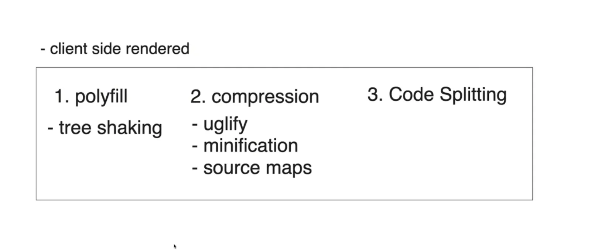
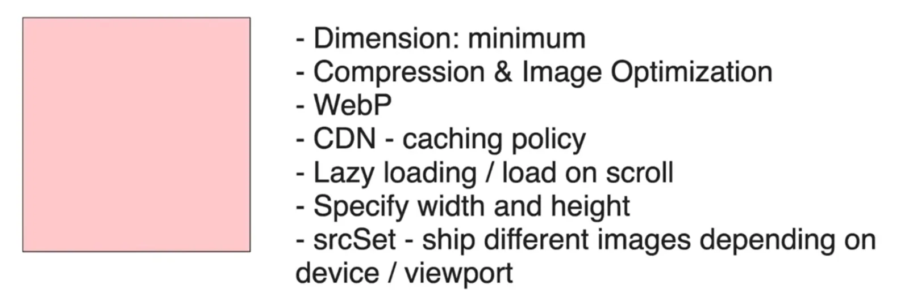
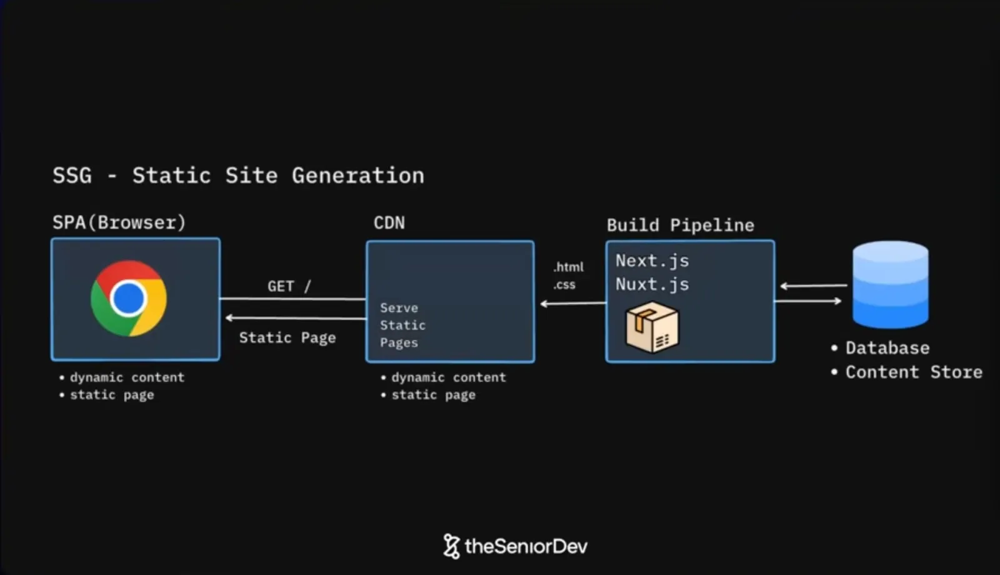
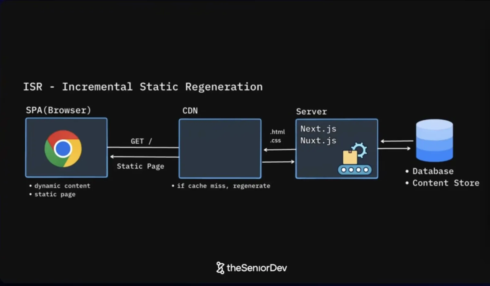
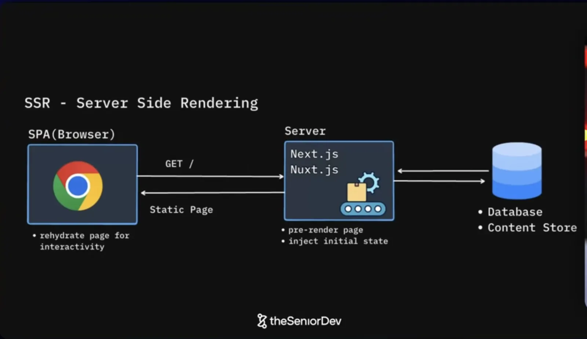

# System Design

Frontend build pipelines, image optimization, architecture patterns and rendering strategies.

## Babel and webpack: build steps in order

For a client-side rendered app, the build runs these steps in order:



1. **Polyfill:** add modern features for older browsers (see [polyfills](/javascript#polyfills)).
   - **Tree shaking:** remove code that is imported but never used.
2. **Compression:**
   - **Uglify** is renaming variables to single letters.
   - **Minification** is minimizing the size of the code to the max: removing line breaks, removing comments, shortening long variables, inlining short functions and removing unreachable "dead" code.
   - **Source map** is an extra file created to map the actual code to the compressed code, so that we can debug in prod in accordance with the source code.
3. **Code splitting:** break the bundle into smaller chunks that load only when needed.

```text
Source ──▶ Polyfill + tree shaking ──▶ Uglify + minify (+ source map) ──▶ Code splitting ──▶ Bundles
```

## Ways to optimize images in an app



- **Dimension:** minimum.
- **Compression** & image optimization.
- **WebP** format.
- **CDN:** caching policy.
- **Lazy loading** / load on scroll.
- **Specify width and height** (prevents layout shift).
- **`srcSet`:** ship different images depending on the device / viewport.

Next.js's [`<Image>` component](/nextjs#the-image-component) does most of these automatically.

## Architecture patterns

### MVC: Model View Controller


```text
View ──▶ Controller ──▶ Model ──▶ View
```

- **Model:** the data and database (`User.model`: id, email, name).
- **View:** what the user sees (`.html` + `.css`).
- **Controller:** the logic in between (`validateEmail()`, `hashPassword()`, `getUserList()`).


| Pros          | Cons              |
| ------------- | ----------------- |
| Dynamic       | Tight coupling    |
| Complex logic | Poor scalability  |
|               | Framework lock-in |

Frameworks: Django, Rails, ASP.NET MVC. **Best fit:** CRUD apps, small teams, fast prototyping.

### BFF + backend microservices


- Each client (**SPA**, **Mobile App**) handles its own client state, client routing and client-side logic.
- Each client gets its own **BFF (Backend for Frontend)** that handles **auth**, **aggregation** and **pagination**.
- The BFF calls independent **backend microservices** (Users, Products, Payments), each with its own REST API, controller and model.

### Modular monolith

A **modular monolith** is the opposite of micro frontends: a **single repo** (and single deployable app), split internally into well-separated modules.

```text
Micro frontends                      Modular monolith
┌──────┐ ┌──────┐ ┌──────┐          ┌─────────────────────────┐
│ App A│ │ App B│ │ App C│          │ ┌─────┐ ┌─────┐ ┌─────┐ │
│ repo │ │ repo │ │ repo │          │ │ mod │ │ mod │ │ mod │ │
└──────┘ └──────┘ └──────┘          │ └─────┘ └─────┘ └─────┘ │
 deployed separately                │  one repo, one deploy   │
                                    └─────────────────────────┘
```

## Rendering strategies

| Strategy | Where HTML is built | When                                          | Example                 |
| -------- | ------------------- | --------------------------------------------- | ----------------------- |
| **SSG**  | Build pipeline      | Once, at build time                           | Blogs, docs             |
| **ISR**  | Server              | At build time, then regenerated on cache miss | Product pages           |
| **SSR**  | Server              | On every request                              | Personalized dashboards |

### SSG: Static Site Generation



- The **build pipeline** (Next.js, Nuxt.js) reads from the database / content store and generates `.html` and `.css`.
- The **CDN** serves the static pages.
- The browser sends `GET /` and receives the static page.

### ISR: Incremental Static Regeneration



- Same as SSG, but a **server** (Next.js, Nuxt.js) sits behind the CDN.
- **If cache miss, regenerate:** the CDN asks the server to rebuild the page from the database / content store.

### SSR: Server Side Rendering



- The browser sends `GET /` straight to the **server** (Next.js, Nuxt.js).
- The server **pre-renders the page** and **injects initial state** from the database / content store.
- The browser **rehydrates the page for interactivity** (see [hydration](/react#hydration)).

## Source

- Diagrams: theSeniorDev
